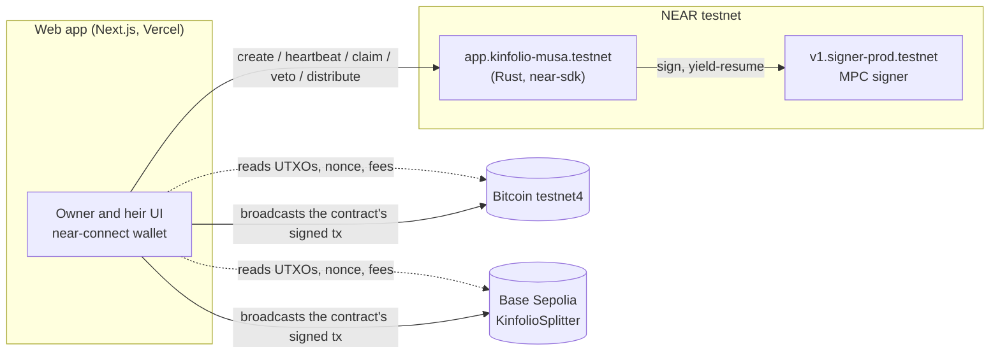

# Kinfolio on NEAR: Architecture

This describes what is built and deployed. What was planned and cut is listed at the end and in the README's honesty table.

## Pitch

Kinfolio is a family trust for self-custodied crypto. A NEAR contract holds native BTC and ETH at an address it controls through Chain Signatures. If the owner goes quiet for longer than they chose, an heir can start a claim, and the owner can veto it during a challenge window. After that, the contract itself builds the transactions that pay each heir their share, and the MPC network signs them. No company holds a key, and nothing is wrapped or bridged.

**Thesis:** *Your keys outlive you, and no company ever holds them.*

What makes it different from a plain inheritance account:

1. **Spending is proof of life.** The owner can spend through the trust (`owner_sign_btc`), and every signature resets the inactivity timer. There is also a plain `heartbeat`.
2. **The contract decides who gets paid, not the caller.** It builds the Bitcoin and EVM transactions from its own heir list. The caller only supplies inputs and a capped fee, so anyone can press "Pay heirs". See "The hard problem" below.

## Problem

| | |
|---|---|
| **Who** | Someone holding their own BTC/ETH who has a family. |
| **Workaround today** | (a) A seed phrase in a drawer or with a lawyer: the heir gets everything at once, or whoever finds it takes it. (b) Collaborative custody (Casa, Unchained, Nunchuk): a company holds one key in a 2-of-3. (c) Nothing, which is the most common case. |
| **Cost** | QuadrigaCX: about C$190M lost when the only keyholder died (2019). Chainalysis has estimated around 20% of mined BTC as lost or stranded (sources in the README). |
| **Sponsor removal test** | Take Chain Signatures away and the trust can't hold native BTC. You're back to a custodian key or a wrapped token, which is exactly the trust problem being removed. |

## Capability map

| User flow | NEAR capability | Exact call |
|---|---|---|
| Create a trust and show its BTC/ETH addresses | Chain Signatures key derivation | `create_trust` calls `v1.signer-prod.testnet.derived_public_key({path: "trust-{id}", predecessor: <contract>, domain_id: 0})`; `on_derived` stores the key. One secp256k1 key per trust gives both the P2WPKH and the 0x address |
| Owner spends while alive (resets the timer) | Chain Signatures signing | `owner_sign_btc(id, utxos, to, amount_sats, fee_sats)` → `sign({request:{path, payload_v2:{Ecdsa:hex}, domain_id:0}})` per input, 1 yocto, resolved via yield/resume into `on_btc_signed` |
| Heir claims → owner vetoes or the window passes → released | Contract state machine | `start_claim`, `veto`, `finalize`; `heartbeat` for the owner |
| Pay heirs in BTC | In-contract tx construction plus signing | `distribute_btc(id, utxos, fee_sats)`: builds a BIP-143 P2WPKH tx with one output per heir (plus change), signs each input, stores the raw tx for broadcast |
| Pay heirs in ETH | Same, EVM | `distribute_evm(...)`: builds an EIP-1559 tx calling `KinfolioSplitter.split(heirs, bps)` on Base Sepolia, signs it, stores the raw tx |

Verified live on 2026-11-02: `v1.signer-prod.testnet` runs v3.18.0 with domain 0 (secp256k1).

## System overview



There is no backend. The browser (or `pnpm e2e`) reads chain state, calls the contract, then broadcasts the raw transaction the contract signed. It can't change who gets paid, because the contract built the transaction.

## Components

- **`contracts/kinfolio`** (Rust, near-sdk 5.30). One contract, many trusts keyed by id. Bitcoin and EVM serialization is hand-rolled in `btc.rs` and `evm.rs` (with `bech32`, `ripemd`, `sha2`) and tested byte-for-byte against `rust-bitcoin` and Foundry.
- **`contracts/splitter`** (Solidity, Foundry). `KinfolioSplitter.split(address[] to, uint16[] bps)` is payable and splits `msg.value` on-chain. Deployed at `0xae3a286351dac27a3ee6662296629538ec1d3f08` on Base Sepolia.
- **`web`** (Next.js 16, React 19, Tailwind 4). Wallet via `@hot-labs/near-connect`. `lib/btc.ts` and `lib/evm.ts` fetch inputs and broadcast; `lib/near.ts` talks to the contract through FastNEAR with a dRPC fallback.
- **`web/scripts/e2e.ts`** runs the whole flow headless against the real rails, using the same modules as the app. Output goes to `docs/evidence/`.

## Data model (contract)

```rust
Trust {
  owner: AccountId,
  state: Active | Challenge | Released,
  inactivity_secs: u32,
  challenge_secs: u32,
  last_heartbeat_ns: u64,        // bumped by heartbeat and owner_sign_btc
  claim_started_ns: Option<u64>,
  claimant: Option<AccountId>,
  heirs: Vec<Heir>,              // bps total 10_000
  pubkey: Option<Vec<u8>>,       // derived key, None while the signer answers
}
Heir { account: AccountId, bps: u16, btc_address: Option<String>, evm_address: Option<String> }
```

## Key flow (the demo)

1. **Create and fund.** The owner creates a trust with two heirs at 60/40 and short demo timers. The page shows the trust's testnet4 and Base Sepolia addresses. The e2e funds them with an MPC-signed BTC spend and a real ETH transfer.
2. **Gone.** The owner goes quiet past the inactivity window. An heir starts a claim; the owner could veto. Once the challenge window passes, `finalize` releases the trust.
3. **Paid.** Anyone calls `distribute_btc` and `distribute_evm`. Both heirs receive 60/40 on testnet4 and Base Sepolia, and the UI shows each step (Build → Sign (MPC) → Broadcast → Confirmed) with explorer links.

## The hard problem: whoever builds the transaction picks the recipient

The obvious design has an off-chain service build the BTC tx and ask the contract to "sign this hash". The contract can't see what a hash pays, so a malicious service (or a bug) could have the trust sign a payment to anyone.

Instead, the contract builds the transaction from its own state. The caller only supplies the UTXOs (txid, vout, value) and a fee, capped at 50,000 sats. The outputs are the heirs' addresses, `bps × (Σinputs − fee)`, plus change back to the trust. Caller-supplied input values are safe because the BIP-143 sighash commits to each input's amount: a wrong value gives an invalid signature and the network rejects the tx. UTXOs left out stay in the trust for the next payout.

On EVM, a transaction commits to `value` but not to the sender's balance. So the split happens on-chain in `KinfolioSplitter`, and a wrong balance only changes the total sent, never the ratio. Gas × max fee is capped at 0.001 ETH.

## Stack choices

| Choice | Why |
|---|---|
| Rust contract | Transaction building and hashing in the contract; the tests compare against `rust-bitcoin` and Foundry |
| One contract with per-trust paths, not a sub-account per trust | Lower storage and deploy cost; derived addresses are just as isolated |
| Testnet only | Chain Signatures signing works on testnet; no mainnet funds needed to judge |
| Base Sepolia | Cheap EVM testnet with good explorers |
| Bitcoin testnet4 | Current Bitcoin test network, supported by Blockstream and mempool.space |

## Planned and cut

| Item | Why it was cut |
|---|---|
| Gasless heir actions (NEP-366 relayer) | Time. Heirs currently need a testnet wallet with a little gas |
| Heir paid in another token via NEAR Intents 1Click | Intents is mainnet only and the build stayed on testnet |
| Proof of life from a Base transfer via MPC foreign-tx verification | Time |
| Removing the contract's full-access key | Kept so fixes could ship during the hackathon; disclosed in the README |

Out of scope: vesting, ERC-20s, guardian sets, Solana, mobile, legal documents, fiat off-ramp.
