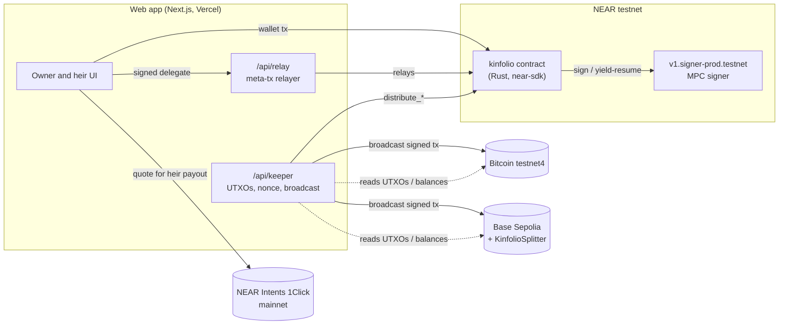

# Kinfolio on NEAR: Architecture

## Pitch

Kinfolio is a family trust for self-custodied crypto. A NEAR contract holds native BTC and ETH at addresses it controls through Chain Signatures. If the owner stops using the money for longer than they chose, their heirs can start a claim. The owner can veto it during a challenge window. After that, the contract itself signs the transactions that pay each heir their share. No company holds a key, and nothing is wrapped or bridged.

**Thesis:** *Your keys outlive you, and no company ever holds them.*

**Why this beats the Open Innovation example prompt** (which is also an inheritance account):

1. **Spending is proof of life.** The owner spends through the trust, and every signature resets the inactivity timer. There's no "I'm alive" button to forget.
2. **The contract decides who gets paid, not the keeper.** It builds the Bitcoin and EVM transactions itself, and the caller only supplies inputs. A lying caller can at worst produce a transaction that the network rejects. See "The hard problem" below.
3. **Heirs need nothing.** They don't need NEAR, gas or a wallet app. Heir actions are gasless meta-transactions, and an heir can ask to be paid in another token on another chain through NEAR Intents.

## Problem

| | |
|---|---|
| **Who** | Someone holding their own BTC/ETH (a "not your keys, not your coins" saver) who has a family. |
| **Workaround today** | (a) A seed phrase in a drawer or with a lawyer: the heir gets everything at once, or anyone who finds it steals it. (b) Collaborative custody (Casa, Unchained, Nunchuk): a company holds one key in a 2-of-3. (c) Nothing, which is the most common case. |
| **Cost** | QuadrigaCX: about C$190M lost when the only keyholder died (2019). Chainalysis has estimated around 20% of mined BTC as lost or stranded. *(To be cited with links in the README.)* |
| **Sponsor removal test** | Take Chain Signatures away and the trust can't hold native BTC. You're back to a custodian key or a wrapped token, which is exactly the trust problem we're removing. |

## Capability map

| User flow | NEAR capability | Exact call |
|---|---|---|
| Create trust and show its BTC/ETH addresses | Chain Signatures key derivation | `v1.signer-prod.testnet.derived_public_key({path, predecessor, domain_id: 0})`, with `path = "<trust_id>/btc"` or `"<trust_id>/evm"` and `predecessor` = our contract |
| Owner spends while alive (heartbeat) | Chain Signatures signing | `kinfolio.owner_sign(trust_id, chain, payload)` → `v1.signer-prod.testnet.sign({request:{path, payload_v2:{Ecdsa:hex}, domain_id:0}})`, 1 yocto deposit, ≥15 Tgas, resolved via yield/resume |
| Heir starts claim → owner vetoes or window passes → released | Plain contract state machine | `start_claim`, `veto`, `finalize` |
| Distribute BTC to heirs | In-contract tx construction plus Chain Signatures | `distribute_btc(trust_id, utxos, fee_sats)`: builds a P2WPKH tx with `omni-transaction-rs`, computes the BIP-143 sighash, then calls `sign` once per input |
| Distribute ETH to heirs | Same, EVM | `distribute_evm(trust_id, nonce, max_fee, balance_wei)`: builds an EIP-1559 tx calling `KinfolioSplitter.split(heirs, bps)` and signs it |
| Heir registers payout address, gasless | Meta transactions (NEP-366) | Heir signs a `SignedDelegateAction`, and our relayer submits it. It only relays calls to `kinfolio.*` |
| Heir is paid in another token or chain | NEAR Intents 1Click | Heir's payout address = a 1Click deposit address from `POST /v0/quote`. **Mainnet only** (Intents has no testnet) |
| *(Stretch)* Proof of life from everyday wallet | MPC foreign-tx verification | `v1.signer-prod.testnet.verify_foreign_transaction` on Base: an ERC-20 `Transfer` log with `from = owner` resets the timer, attested by the MPC network instead of an oracle |

Verified live on 2026-11-02: the testnet signer `v1.signer-prod.testnet` runs v3.18.0. It has domains 0 (secp256k1 Sign), 1 (ed25519 Sign) and 3 (ForeignTx). Its foreign-chain verification on testnet covers Solana, Base, Arbitrum, Polygon, BNB and others. Bitcoin verification is **mainnet only**.

## System overview



## Components

- **`contracts/kinfolio`** (Rust, near-sdk 5.x, built with `cargo-near`). One contract, many trusts, keyed by `trust_id`. Each trust's foreign addresses come from the path `"{trust_id}/{chain}"` under the contract's account. After deploy we delete the full-access key so the contract can't be changed (an honesty-table item until we do).
- **`contracts/splitter`** (Solidity, Foundry). `KinfolioSplitter.split(address[] to, uint16[] bps)` is payable and splits `msg.value` by bps on-chain. Deployed once on Base Sepolia.
- **`web`** (Next.js App Router, TypeScript, Tailwind). The wallet is `@hot-labs/near-connect`. Foreign-chain helpers use `chainsig.js` (address derivation, UTXO fetch, broadcast). The route handlers are the relayer and the keeper.
- **`scripts/e2e.ts`** runs the full flow headless against testnet using the same modules as the web app. Its output is saved to `docs/evidence/`.

## Data model (contract)

```rust
Trust {
  owner: AccountId,
  state: Active | Challenge | Released | Closed,
  inactivity_secs: u32,       // demo: 120
  challenge_secs: u32,        // demo: 60
  last_heartbeat: u64,        // ns; bumped by owner_sign, heartbeat, (stretch) verified foreign activity
  claim_started_at: Option<u64>,
  claimant: Option<AccountId>,
  heirs: Vec<Heir>,           // bps must total 10_000
  distributions: Vec<DistributionRecord>, // per chain: tx hash placeholder, amount, at
}
Heir { account: AccountId, bps: u16, payout: Map<Chain, String> } // BTC bech32 / 0x address / 1Click deposit address
Chain = Btc | Evm
```

Out of Kinfolio's EVM design for now: cash/portfolio sleeves, per-grant vesting, and grant transfer.

## Key flows (the demo)

1. **Create and fund.** The owner creates a trust (2 heirs, 60/40, 2-minute inactivity, 1-minute challenge). The UI shows the trust's BTC testnet4 and Base Sepolia addresses, and the owner funds them from faucets.
2. **Alive.** The owner sends 1,000 sats out through `owner_sign`. The heartbeat on the trust's timeline resets, and the mempool link proves the tx.
3. **Gone.** No activity for 2 minutes. The heir taps "Start claim" (gasless). A countdown runs and the owner could veto. After 1 minute: `finalize`, then `distribute_btc` and `distribute_evm`. Both heirs receive 60/40 on testnet4 and Base Sepolia, with explorer links, and every step is named in the UI.
4. **Mainnet proof (Intents).** On mainnet with about $5: an heir's ETH share on Base goes to a 1Click deposit address and arrives as USDC on NEAR, with the status polled until `SUCCESS`.

## The hard problem: whoever builds the transaction picks the recipient

The obvious design has the keeper build the BTC tx off-chain and ask the contract to "sign this hash". The contract can't see what a hash pays, so a malicious keeper (or a bug) could have the trust sign a payment to anyone.

What we do instead: the contract builds the transaction from its own state. The caller only supplies the UTXOs (txid, vout, value) and a fee, and the fee is capped by the contract. The outputs are the heirs' registered addresses, `bps × (Σinputs − fee)`, plus change back to the trust address. We can trust caller-supplied input values because the BIP-143 segwit sighash commits to each input's amount. If the keeper lies about a value, the signature is invalid and the network rejects the tx. If it leaves UTXOs out, they stay in the trust for the next distribution.

On EVM, a transaction commits to `value` but not to the sender's balance. So the split happens on-chain in `KinfolioSplitter`, and a lying `balance_wei` only changes the total sent, never the ratio.

A test guards each case: tampered input value → invalid sig, and wrong heir set → contract panics.

## Stack choices

| Choice | Why |
|---|---|
| Rust contract, not near-sdk-js | `omni-transaction-rs` (building BTC and EVM transactions in the contract) is Rust only |
| One contract with per-trust paths, not a sub-account per trust | Lower storage and deploy cost; the derived addresses stay just as isolated |
| Testnet for signing, mainnet only for Intents | Intents has no testnet. HACKATHON.md allows mainnet where an integration is mainnet only |
| Base Sepolia over Ethereum Sepolia | Cheap, and it's a foreign chain the MPC network can verify on testnet (the stretch goal) |
| Bitcoin testnet4 | What chainsig.js and mempool.space currently support for testing |

## Out of scope

Vesting schedules, ERC-20s other than the stretch goal, guardian sets, sleeves, Solana, mobile, legal documents, fiat off-ramp.

## Milestones (deadline 14 Nov 23:59 UTC)

| # | Days | Ships | Done when |
|---|---|---|---|
| M1 | 2–4 Nov | Contract (create, heartbeat, `owner_sign`, state machine) on testnet; web app showing the trust and derived addresses, live on Vercel | The owner signs a real testnet4 BTC spend from the UI, and the heartbeat resets on-chain |
| M2 | 5–7 Nov | `distribute_btc` and `distribute_evm` built in-contract, the splitter deployed, keeper, `npm run e2e` | Headless e2e: create → fund → lapse → claim → finalize → both heirs paid; log in `docs/evidence/` |
| M3 | 8–9 Nov | Gasless heir actions (relayer), heir view, demo mode ("Reset & launch demo"), 1Click payout on mainnet | An heir with no NEAR balance completes a claim; a mainnet 1Click payout reaches `SUCCESS` |
| M4 | 10 Nov | *(stretch)* MPC-verified proof of life from Base | A Base Sepolia USDC transfer by the owner resets the timer through `verify_foreign_transaction` |
| Ship | 11–13 Nov | README, demo video, X post, submission | Submitted with a day to spare |
