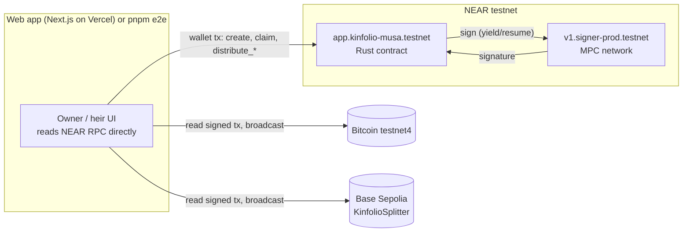
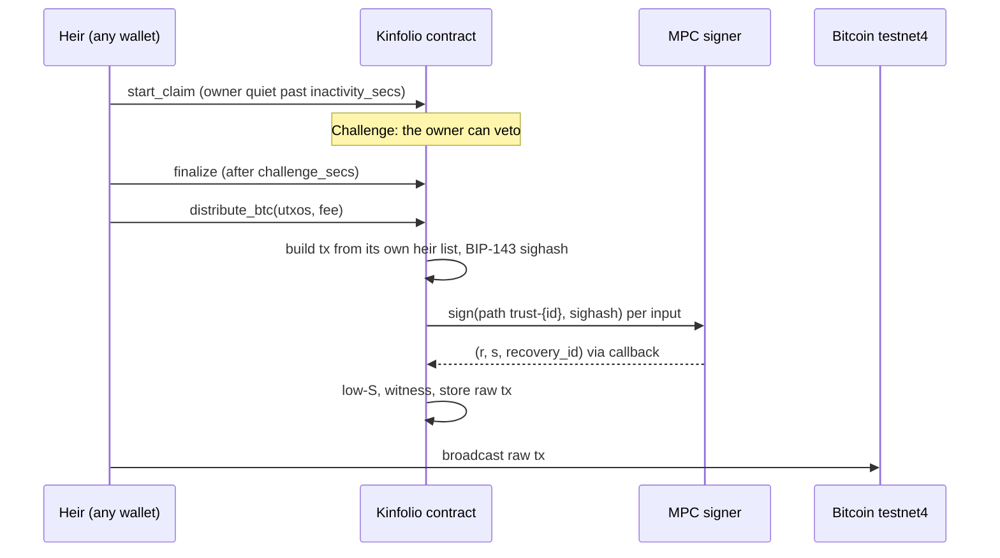

# Kinfolio on NEAR

   

### Your keys outlive you, and no company ever holds them.

Kinfolio is a family trust for self-custodied crypto. A NEAR contract holds **native** Bitcoin and ETH at addresses it controls through Chain Signatures. If the owner goes quiet for longer than they chose, an heir can start a claim, and the owner can veto it during a challenge window. After that, the contract itself builds and signs the transactions that pay each heir their share. Nothing is wrapped or bridged, and no server holds a key.

**[Demo video](#demo)** · **[Live app](https://kinfolio-near.vercel.app)** · **[A trust that paid out](https://kinfolio-near.vercel.app/trust/6)** · [Verify it yourself](#verify-it-yourself-in-60-seconds) · [Architecture](ARCHITECTURE.md) · [Run it locally](#run-it-locally)

## Demo

**[Watch the demo (1:48)](docs/kinfolio-demo.mp4)**. It is a real recording of [trust 6](https://kinfolio-near.vercel.app/trust/6) going from created to paid out while `pnpm e2e` drove it against NEAR testnet, Bitcoin testnet4 and Base Sepolia. Sped-up parts are labelled on screen. Shot list: [docs/demo-script.md](docs/demo-script.md).

## Verify it yourself in 60 seconds

**1. Read the trust from the chain** (no wallet, no key):

```bash
curl -s https://test.rpc.fastnear.com -H 'content-type: application/json' -d '{"jsonrpc":"2.0","id":1,"method":"query","params":{"request_type":"call_function","finality":"final","account_id":"app.kinfolio-musa.testnet","method_name":"get_trust","args_base64":"eyJpZCI6Nn0="}}' \
  | python3 -c "import sys,json;print(bytes(json.load(sys.stdin)['result']['result']).decode())"
```

Expect `"state":"Released"`, two heirs at `6000`/`4000` bps, and the trust's own addresses `tb1qpjcj9cmzv8cu3qjnw74kw20j69lk6k97uh94f3` and `0xf55d8eea597f92078abf890feda08995b7ce6cf9`.

**2. Check that the money moved** (trust 6, 13 Nov 2026):

| What | Where |
|---|---|
| BTC payout: one input, 5,195 sats to heir A and 3,464 sats to heir B | [blockstream.info/testnet4/tx/e3bc1618…d827cb](https://blockstream.info/testnet4/tx/e3bc1618b16df5291a063dc57dcedcb74c57b0bbadb7e8cc6cf0165a03d827cb) |
| ETH payout through the splitter: 0.00119902 / 0.00079935 ETH (60/40) | [base-sepolia.blockscout.com/tx/0xc2e2b258…a5bcfd](https://base-sepolia.blockscout.com/tx/0xc2e2b258c67d0c6ed17619a958ada9d54ffbad892d89fa77f9b866fe90a5bcfd?tab=internal) |
| The contract | [app.kinfolio-musa.testnet](https://testnet.nearblocks.io/address/app.kinfolio-musa.testnet) |
| The splitter on Base Sepolia | [0xae3a2863…ec1d3f08](https://sepolia.basescan.org/address/0xae3a286351dac27a3ee6662296629538ec1d3f08) |
| Full run log, every step and link | [docs/evidence/e2e-2026-11-13-00-02.txt](docs/evidence/e2e-2026-11-13-00-02.txt) |

**3. Run the tests**:

```bash
cd contracts/kinfolio && cargo test     # 28 passed
cd contracts/splitter && forge test     # 6 passed, incl. a 256-run fuzz
```

**4. Run the whole flow yourself**: `cd web && pnpm e2e` (needs testnet accounts and coins, see [Run it locally](#run-it-locally)). It creates a trust, funds it with real testnet4 BTC (an MPC-signed spend from another trust) and Base Sepolia ETH, waits out the owner, claims, finalizes, and pays both heirs on both chains. A clean run takes about 2.5 minutes.

## Contents

- [The problem](#the-problem)
- [What it does](#what-it-does)
- [Architecture](#architecture)
- [The hard problem](#the-hard-problem)
- [What's real vs simplified](#whats-real-vs-simplified)
- [Engineering decisions](#engineering-decisions)
- [Project layout](#project-layout)
- [Run it locally](#run-it-locally)
- [Limitations and disclosure](#limitations-and-disclosure)

## The problem

People who hold their own BTC and ETH have three options for what happens when they die:
- A seed phrase in a drawer or with a lawyer, where whoever finds it gets everything at once.
- A custody company holding one key in a 2-of-3.
- Most commonly, nothing.

Chainalysis estimated that about 20% of all bitcoin appeared to be lost or stranded ([reported Jan 2021](https://vancouverisland.ctvnews.ca/sci-tech/article/chances-are-basically-zero-of-recovering-some-bitcoin-passwords-worth-millions-cryptocurrency-firm)).

**Remove NEAR and the product stops working.** Without Chain Signatures the trust can't hold native Bitcoin at all, and you're back to a custodian's key or a wrapped token. That's the trust problem Kinfolio exists to remove.

## What it does

| Flow | What the user does | NEAR capability and call |
|---|---|---|
| Create a trust | Owner names heirs, shares (bps) and two timers | `create_trust` → the contract asks `v1.signer-prod.testnet.derived_public_key` for path `trust-{id}` (predecessor = the contract) and stores the BTC (P2WPKH) and EVM addresses in a callback |
| Owner spends, proving they're alive | Owner sends BTC out of the trust | `owner_sign_btc(id, utxos, to, amount, fee)`: the contract builds the tx, computes the BIP-143 sighash and calls the MPC `sign` once per input (yield/resume, 1 yocto). Every owner signature resets the inactivity clock. A plain `heartbeat` also does. |
| Claim and veto | Heir starts a claim once the owner has been quiet; the owner can veto; anyone finalizes after the window | `start_claim`, `veto`, `finalize` (contract state machine: Active → Challenge → Released) |
| Heirs set where to be paid | Heir saves a `tb1q…` and a `0x…` address | `set_payout(id, btc_address, evm_address)` |
| Pay the heirs in BTC | Anyone presses "Pay heirs in BTC" | `distribute_btc(id, utxos, fee_sats)`: outputs come from the contract's own heir list, then MPC `sign` per input |
| Pay the heirs in ETH | Anyone presses "Pay heirs in ETH" | `distribute_evm(id, nonce, fees, gas, value)`: an EIP-1559 tx to `KinfolioSplitter.split(heirs, bps)` on Base Sepolia, signed by MPC |

Every action in the app shows named steps (build → MPC sign → broadcast → confirmed), and none says "done" until the chain does.

## Architecture





Contract methods: `create_trust`, `heartbeat`, `start_claim`, `veto`, `finalize`, `set_payout`, `owner_sign_btc`, `distribute_btc`, `distribute_evm`. Views: `get_trust`, `trusts_of`, `trusts_for`, `get_last_signed`, `get_last_signed_evm`, `get_splitter`, `next_trust_id`. Details in [ARCHITECTURE.md](ARCHITECTURE.md).

## The hard problem

**Whoever builds the transaction picks the recipient.** The obvious design has an off-chain keeper build the payout and ask the contract to "sign this hash". The contract can't see what a hash pays, so a buggy or malicious keeper could have the trust sign a payment to anyone.

Kinfolio's contract builds every transaction from its own state instead.

- **Bitcoin.** The caller supplies only UTXOs `(txid, vout, value)` and a fee. The fee is capped at 50,000 sats, with at most 3 inputs. The outputs are always the heirs' saved addresses at `bps × (inputs − fee)`, and the last heir gets the remainder. Caller-supplied values can be trusted because the BIP-143 sighash commits to each input's amount: a wrong value gives an invalid signature that the network rejects, never a payment elsewhere.
- **EVM.** A transaction commits to `value` but not to the sender's balance. So the split happens on-chain in `KinfolioSplitter`, and the heir list and bps are encoded by the contract. A wrong `value` changes only the total, never who gets what. The fee is capped too (`max_fee × gas ≤ 0.001 ETH`, gas ≤ 300k).

That's why the payout button can be public. Whoever presses it pays NEAR gas and nothing else.

## What's real vs simplified

| Capability | How it's backed | Status |
|---|---|---|
| Native BTC held by a NEAR contract | Chain Signatures, testnet MPC signer | Real (testnet4) |
| Native ETH held by a NEAR contract | Chain Signatures, EIP-1559 to Base Sepolia | Real (testnet) |
| Payout to heirs on both chains | `distribute_btc` / `distribute_evm` + KinfolioSplitter | Real, verified by `pnpm e2e` (trusts 4 and 6) |
| Owner spending resets the clock | `owner_sign_btc` resets on **signing**, not on broadcast confirmation | Simplified |
| Gasless heirs (meta-tx relayer) | Planned, cut for time: heirs need a NEAR testnet wallet with a little gas | Not built |
| Heir paid in another token via NEAR Intents 1Click | Planned, cut: Intents is mainnet only and we stayed on testnet | Not built |
| Proof of life from the owner's everyday wallet (`verify_foreign_transaction`) | Stretch, cut | Not built |
| Immutable contract | The contract account still has its full-access key, so the author could redeploy it | Not yet locked |
| Fees and UTXO selection | Chosen client-side (Esplora fee estimate, largest 3 UTXOs); the contract caps them | Simplified |

## Engineering decisions

- **BIP-143 and EIP-1559 serialization written in the contract (Rust), not pulled in from a crate.** That keeps the wasm at 280 KB. It's guarded by `signed_tx_matches_foundry_byte_for_byte` (our bytes equal `cast mktx` output), `sighash_recovers_to_the_signing_key`, and a rust-bitcoin cross-check of the BTC sighash (`examples/verify_signed.rs`).
- **Low-S normalization.** Bitcoin and Ethereum both reject high-S signatures, and on EVM, flipping S also flips the recovery parity. The contract handles both.
- **No state migration.** The splitter address and the EVM signatures live under raw storage keys, not new struct fields, so in-place redeploys kept every existing trust and its coins.
- **Reads need no wallet.** The app reads NEAR RPC directly, so anyone can open a trust page.
- **Rails fail over.** RPC calls fall back FastNEAR → dRPC on rate limits only. Bitcoin calls fall back mempool.space → Blockstream Esplora. Both were real outages during the build ([docs/build-log.md](docs/build-log.md)).
- **Base's L1 data fee.** Base is an OP-stack L2, and "send the whole balance" failed until the payout reserved `GasPriceOracle.getL1FeeUpperBound`.

## Project layout

```
contracts/kinfolio   # Rust NEAR contract: trusts, state machine, BTC + EVM tx building, MPC calls (28 tests)
contracts/splitter   # Solidity KinfolioSplitter, Foundry (6 tests)
web/                 # Next.js app (app/, components/, lib/) and the headless e2e (scripts/e2e.ts)
docs/                # build log, evidence logs, demo script, submission text
```

## Run it locally

Prerequisites: Node 22 and pnpm. To work on the contracts, also Rust with `cargo-near` and Foundry.

```bash
# web app against the live testnet contract (no env needed)
cd web && pnpm install && pnpm dev          # http://localhost:3000

# contract
cd contracts/kinfolio && cargo test && cargo near build non-reproducible-wasm

# splitter
cd contracts/splitter && forge test
```

To run `pnpm e2e` with your own accounts:
1. Copy `.env.example` to `.env`.
2. Put the owner and two heir testnet keys in `~/.near-credentials/testnet/`. The near-cli layout works.
3. Give the owner an Active trust holding some testnet4 BTC, and set its ID in `E2E_FUND_FROM_TRUST`.
4. Set a Base Sepolia key with about 0.003 ETH in `DEPLOYER_EVM_PRIVATE_KEY`, and install Foundry's `cast`.

Every variable is listed in [.env.example](.env.example).

## Limitations and disclosure

- Built for NEAR HACKATHON 2026 (tracks: Open Innovation, Real-World Money). Development started 2 Nov 2026.
- Kinfolio began as an EVM product by the same author. This repository is a new, NEAR-native implementation written during the hackathon window. No EVM Kinfolio code is reused, only the design idea of the inactivity → challenge → release state machine.
- Libraries:
  - Contract: `near-sdk` 5.30, `bech32`, `ripemd`, `sha2`, `hex`; `bitcoin` (rust-bitcoin) in tests only.
  - Splitter: `forge-std`.
  - Web: Next.js 16, React 19, Tailwind 4, `@hot-labs/near-connect`, `@near-js/providers`, `lucide-react`; `near-api-js` and `tsx` for the e2e.
- AI coding assistants (Claude Code) were used throughout.
- Testnet software. Not financial or legal advice.
